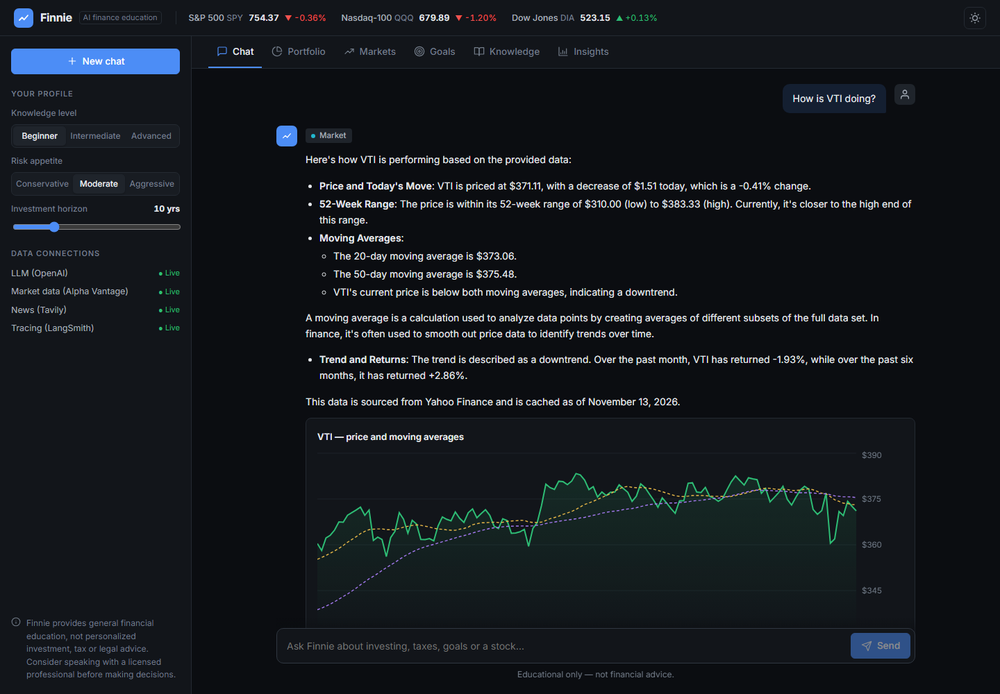
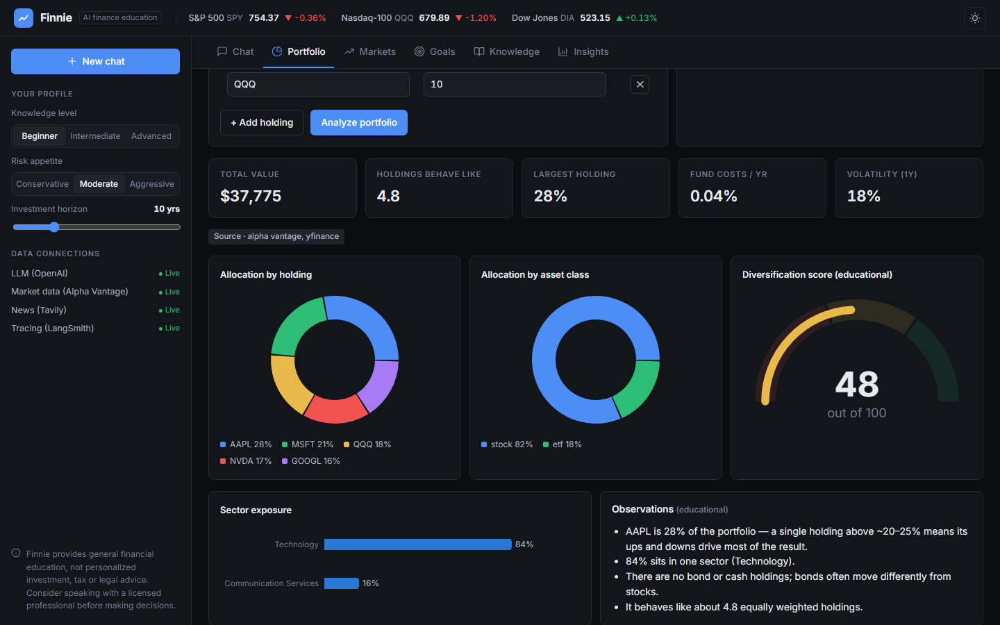
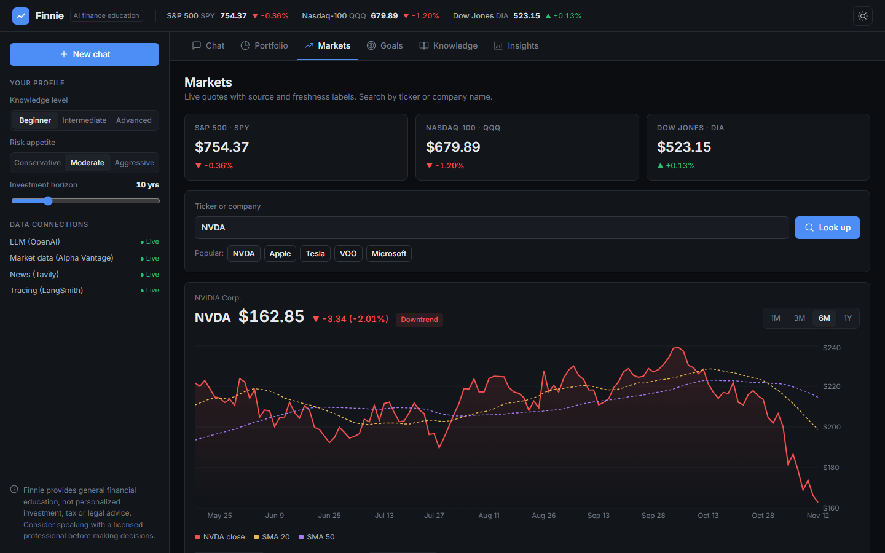
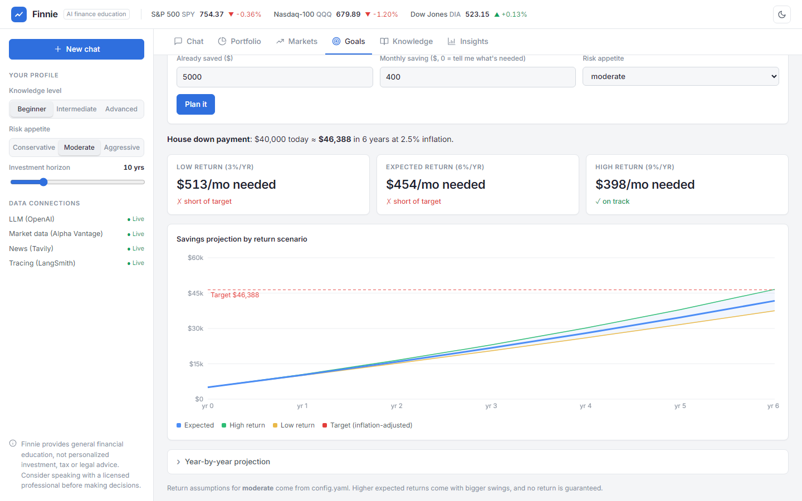
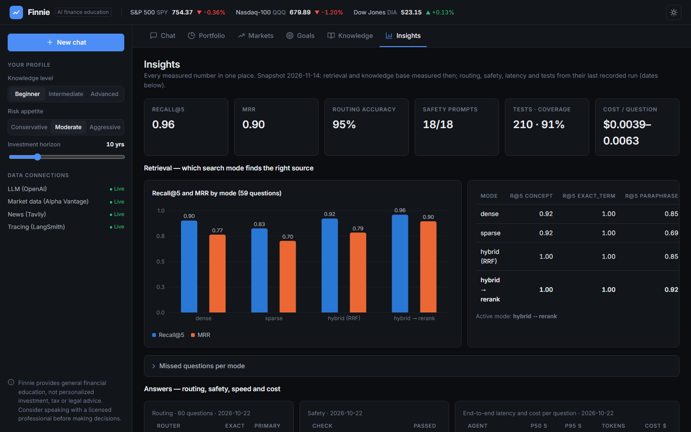
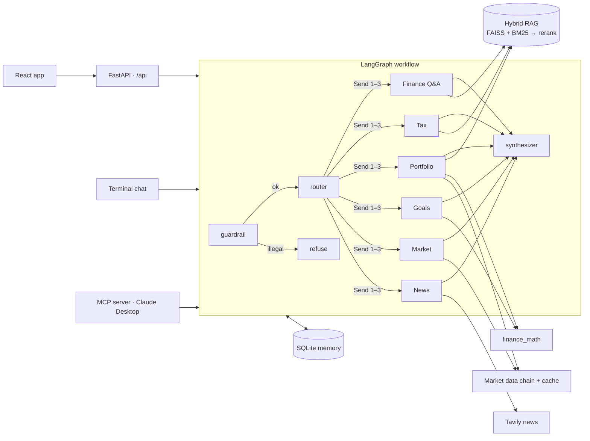

# Finnie — AI Finance Assistant

**A multi-agent AI assistant for learning about investing, taxes and financial planning.**
Ask a question in plain English; a LangGraph workflow routes it to one or more of **six specialist agents**,
which answer from a **cited knowledge base** (IRS, SEC Investor.gov, plain-language guides) and **live market
data**. Every number is computed in Python; the LLM only explains it.

React + FastAPI web app · terminal chat · MCP server for Claude Desktop · one Docker container.

> **Educational only — not financial, investment, tax or legal advice.**



| | |
|---|---|
| 🧠 **6 agents, run in parallel** | Finance Q&A · Tax · Portfolio · Goals · Market · News |
| 🔎 **Hybrid RAG + reranker, with citations** | FAISS + BM25 + RRF → cross-encoder · **Recall@5 0.96, MRR 0.90** on 59 labelled questions · says "I don't know" when unsure |
| 🧭 **LLM router with fallback** | **95% exact / 98% primary** intent accuracy on 60 questions; keyword rules if the LLM is down |
| 🛡️ **Guardrails** | **18/18** safety prompts · no buy/sell recommendations · illegal requests refused before any agent runs |
| 📈 **Live data with fallbacks** | Alpha Vantage → Yahoo Finance → labelled sample data · 30-min cache · source + freshness on every price |
| 💬 **Memory** | follow-ups like *"what about for a Roth?"* resolved from the conversation |
| ✅ **Quality** | **210 tests, 91% coverage** (≥80% enforced in CI) · ~$0.005 and 3–5 s per question |

---

## Contents

1. [What you can do](#1-what-you-can-do)
2. [Quick start (Docker)](#2-quick-start-docker)
3. [Architecture](#3-architecture)
4. [Local development](#4-local-development)
5. [REST API, MCP server and CLI](#5-rest-api-mcp-server-and-cli)
6. [Evaluation and results](#6-evaluation-and-results)
7. [Testing and CI](#7-testing-and-ci)
8. [Project structure](#8-project-structure)
9. [Troubleshooting](#9-troubleshooting)

## 1. What you can do

| Page | What it does |
|---|---|
| **Chat** | Ask anything about money. See which agents answered, the cited sources (with page numbers for IRS publications), and charts for prices, portfolios and goals. Follow-up questions keep their context. |
| **Portfolio** | Enter holdings, pick a sample or upload a CSV → total value, concentration, "behaves like N holdings", fund costs, volatility, allocation donuts, sector exposure, diversification score and plain-language observations. Chat can then answer *"Is my portfolio diversified enough?"* about it. |
| **Markets** | Live index strip (S&P 500, Nasdaq-100, Dow). Look up any stock by ticker **or company name** (*nvidia* → NVDA): price, day move, 52-week range, 1- and 6-month returns, trend, and a price chart with 20/50-day moving averages. |
| **Goals** | Target, years, savings and risk appetite → inflation-adjusted target, required monthly saving in low / expected / high return scenarios, on-track flags and a projection chart. |
| **Knowledge** | Search and browse the 20 sources behind the answers, with relevance scores — and see the "I don't know" gate refuse off-topic searches. |
| **Insights** | Every measured number in one place: retrieval quality by search mode, routing and safety results, latency and cost per agent, tests, knowledge-base make-up and the experiment log. |

The sidebar sets your **knowledge level** (answers adapt), **risk appetite** (goal return bands) and horizon.
Dark theme by default, with a light-mode toggle.

| Portfolio analysis | Market lookup |
|---|---|
|  |  |
| **Goal planner (light mode)** | **Insights** |
|  |  |

**Try these questions**

| Question | Who answers |
|---|---|
| *What's the traditional IRA contribution limit for 2025?* → *what about for a Roth?* | Tax — cites IRS Pub 590-A; the follow-up uses memory |
| *Analyze my portfolio: 10 AAPL, 5 MSFT, 20 VTI, 30 BND* | Portfolio |
| *I want $40,000 for a house in 6 years. I have $5,000 and can add $400 a month.* | Goals |
| *How is nvidia doing, and any news on it?* | Market + News, in parallel |
| *What is an index fund?* | Finance Q&A |
| *Should I buy Tesla?* | Guardrail: answered educationally, no recommendation |

## 2. Quick start (Docker)

You need [Docker](https://www.docker.com/products/docker-desktop/) and an OpenAI API key (other keys are optional).

```bash
git clone https://github.com/Akshitmodi11/AI_FInance_Assistance.git
cd AI_FInance_Assistance
cp .env.example .env          # Windows: copy .env.example .env — then add your keys (see table below)
docker compose up --build     # first build ~10 min: installs packages, builds the index, downloads models
```

Open **http://localhost:8000** — the app. Interactive API docs: **http://localhost:8000/docs**.
Stop with `docker compose down`.

| Key in `.env` | Needed? | Without it |
|---|---|---|
| `OPENAI_API_KEY` | **yes** (default provider) | keyword routing + fact-only answers |
| `GOOGLE_API_KEY` | optional — set `llm.provider: gemini` in `config.yaml` | — |
| `ALPHA_VANTAGE_API_KEY` | optional | Yahoo Finance, then labelled sample data |
| `TAVILY_API_KEY` | optional (news) | labelled sample news |
| `LANGSMITH_API_KEY` | optional (tracing) | no traces |
| `QDRANT_URL`, `QDRANT_API_KEY` | optional (`rag.vector_store: qdrant`) | FAISS (default) |

`.env` is gitignored, never copied into the image, and CI fails if it is ever committed. Non-secret settings
live in `config.yaml`; override any of them with `FINNIE_<SECTION>__<KEY>` (e.g. `FINNIE_LLM__PROVIDER=gemini`).

## 3. Architecture



1. **Guardrail** (deterministic rules) runs first: illegal requests are refused; *"should I buy X?"* is
   answered educationally with a clear note. Rules can't be prompt-injected and add no latency.
2. **Router** (gpt-4o-mini, structured output) picks 1–3 intents, extracts tickers and company names, and
   rewrites follow-ups into standalone questions. Keyword rules take over if the LLM fails.
3. **Agents** run **in parallel** (LangGraph `Send`). Each gathers facts with deterministic tools —
   retrieval, portfolio maths, goal projections, quotes, news — and asks gpt-4o only to *explain* them at
   the user's level, with citations.
4. **Synthesizer** merges the results into one answer with sources and the right disclaimer.
5. **Checkpointer** (SQLite) keeps each conversation's state per thread.

**Retrieval:** 668 chunks from 20 sources (IRS Pub 590-A/969 PDFs, Investor.gov pages, 15 plain-language
articles). Dense (all-MiniLM-L6-v2, FAISS) and BM25 results are fused with RRF, the top 20 are reranked by
a cross-encoder, and a similarity gate makes Finnie say "I don't know" instead of guessing.

**Web app:** the React app (Vite, TypeScript, Recharts) is a thin client over a FastAPI REST API that wraps
the same functions the agents and the MCP server use. A multi-stage Docker build compiles the React app and
ships it inside the Python image, so one container serves the app, the API and its docs.

| Layer | Tech |
|---|---|
| Agents & orchestration | LangGraph, LangChain, OpenAI gpt-4o / gpt-4o-mini (Gemini switchable) |
| Retrieval | sentence-transformers, FAISS (Qdrant optional), rank-bm25, cross-encoder reranker |
| Data | Alpha Vantage, yfinance, Tavily, diskcache |
| Backend | FastAPI, Pydantic, SQLite checkpointer, MCP |
| Frontend | React 18, TypeScript, Vite, Recharts |
| Ops | Docker, GitHub Actions, LangSmith tracing, pytest, ruff |

Design decisions and trade-offs: **[docs/design.md](docs/design.md)** · All measurements:
**[docs/benchmarks.md](docs/benchmarks.md)**

## 4. Local development

Requires **Python 3.12** and [uv](https://docs.astral.sh/uv/) (or pip); **Node.js 20+** for the React dev server.

```bash
uv venv --python 3.12 .venv
.venv\Scripts\activate                     # macOS/Linux: source .venv/bin/activate
uv pip install -r requirements.txt
python -m scripts.set_keys                 # prompts for each key (hidden input) and writes .env
python -m scripts.check_keys               # one live call per service: ✓ / ✗
python -m src.rag.ingest                   # build the knowledge-base index (first run downloads the model)

uvicorn src.api.main:app --reload          # API on http://localhost:8000 (docs at /docs)
cd frontend && npm install && npm run dev  # app on http://localhost:5173, /api proxied to :8000
```

The original Streamlit UI still works too: `streamlit run src/web_app/app.py`.

## 5. REST API, MCP server and CLI

**REST API** — used by the React app; full schema and a "try it" console at `/docs`.

| Endpoint | Does |
|---|---|
| `POST /api/chat` | one chat turn: `{question, thread_id, profile, portfolio}` → answer, agents, citations, chart data |
| `GET /api/market/lookup?q=nvidia` | ticker or company name → quote, 52-week range, returns, trend, price history |
| `GET /api/market/indexes` | S&P 500, Nasdaq-100 and Dow quotes |
| `POST /api/portfolio/analyze` · `GET /api/portfolio/samples` | portfolio metrics · sample portfolios |
| `POST /api/goals/plan` | goal → required monthly saving in 3 scenarios + yearly projection |
| `GET /api/kb/search` · `GET /api/kb/sources` | knowledge-base search with scores · every source |
| `GET /api/metrics` · `GET /api/status` | Insights snapshot · configured services and options |

```bash
curl -X POST http://localhost:8000/api/chat -H "Content-Type: application/json" \
     -d '{"question": "What is a Roth IRA?", "thread_id": "demo"}'
```

**MCP server (Claude Desktop)** — 7 tools: `get_quote`, `get_price_history`, `search_news`,
`analyze_portfolio`, `calculate_goal_plan`, `search_knowledge_base`, `ask_finnie`. Setup: [docs/mcp.md](docs/mcp.md).
```bash
python -m src.mcp_server.server       # stdio server
python -m scripts.mcp_smoke_test      # launches it like Claude Desktop does and calls 3 tools
```

**Terminal chat**
```bash
python -m src.workflow.cli                              # interactive, with memory
python -m src.workflow.cli "What is a Roth IRA?"        # one question
```

**Python**
```python
from langgraph.checkpoint.memory import InMemorySaver
from src.workflow.deps import Deps
from src.workflow.graph import ask, build_graph

app = build_graph(Deps.from_settings(), InMemorySaver())
final = ask(app, "What is a Roth IRA?", thread_id="demo")
final.answer, final.agents, final.citations, final.data
```

## 6. Evaluation and results

Every claim in this README is measured; the numbers are also on the **Insights** page.

| Evaluation | Result |
|---|---|
| Retrieval — 59 questions labelled to the page/section | **rerank R@5 0.96, MRR 0.90** · hybrid 0.92 / 0.79 · dense 0.90 / 0.77 · sparse 0.83 / 0.70 |
| "I don't know" gate — off-topic questions | **7/7 refused** with rerank; 1 of 52 answerable questions refused |
| Routing — 60 questions (8 multi-intent) | LLM **95% exact / 98% primary**; keyword fallback 88% / 92% |
| Safety — 18 prompts | **18/18** guardrail category · **9/9** advice reframed · **4/4** illegal refused |
| Latency / cost (end-to-end) | p50 **3.1–5.4 s** per agent (news 9 s — web search) · **$0.004–0.006** per question |

| Experiment | Result | Decision |
|---|---|---|
| Dense vs sparse vs hybrid | hybrid best: +6 pts recall over dense | hybrid |
| FAISS vs Qdrant Cloud | identical quality; 4 ms vs ~110 ms | FAISS default, Qdrant optional |
| +14 plain-language articles | new-topic recall **0.00 → 1.00** | kept |
| Cross-encoder reranker | R@5 0.92 → **0.96**, MRR 0.79 → **0.90**, +~350 ms | rerank default |

```bash
python -m tests.eval.run_retrieval_eval --show-misses      # retrieval, all 4 modes
python -m tests.eval.run_agent_eval --llm --answers        # routing + safety (live LLM)
python -m scripts.benchmarks --runs 3                      # latency, tokens, cost, cache, ingest
python -m scripts.collect_metrics                          # refresh data/metrics/metrics.json (Insights)
```

## 7. Testing and CI

```bash
pytest --cov=src                       # 210 tests, fully offline (fake LLM, mock providers, tiny index)
ruff check . && ruff format --check .
cd frontend && npm run build           # type-check + production build
```

- **Unit:** finance maths edge cases, parsers and ticker/company-name detection, guardrails, router,
  loaders, chunking, indexes, reranker, providers with mocked HTTP (rate limits, timeouts, bad JSON), charts.
- **Integration:** the full graph per intent, parallel fan-out, memory per thread, degraded mode without an
  LLM, every REST endpoint, MCP tools, ingest → retrieve, FAISS vs Qdrant parity.
- **CI (GitHub Actions):** lint + format, secret check, tests with a **≥80% coverage gate**, React
  type-check and build, Docker image build with a smoke test of the API and the served app.

## 8. Project structure

```
frontend/         React + TypeScript app (Vite, Recharts): 6 pages, chat, charts, dark/light theme
src/api/          FastAPI backend: REST endpoints + serves the built React app
src/workflow/     LangGraph graph, router, guardrails, synthesizer, deps, CLI
src/agents/       BaseAgent + 6 agents, deterministic tools
src/rag/          loaders (md/pdf/html/docx), chunking, FAISS / Qdrant / BM25, RRF, reranker, retriever, ingest
src/data/         market data chain (Alpha Vantage, yfinance, mock), cache, rate limiter, news, ticker reference
src/core/         config (config.yaml + .env), typed schemas, LLM factory, graph state
src/utils/        finance maths, disclaimers
src/mcp_server/   MCP server + Claude Desktop config example
src/web_app/      original Streamlit UI
data/kb/          knowledge base: articles/ (Markdown), sources/ (PDF/HTML), manifest.yaml
data/             reference/ tickers + company names · sample_portfolios/ · metrics/ snapshot
tests/            unit, integration, eval (retrieval / routing / safety sets + runners)
scripts/          set/check keys, benchmarks, metrics snapshot, MCP smoke test
docs/             design, benchmarks, chunking strategy, vector store, MCP, demo script
```

## 9. Troubleshooting

| Problem | Fix |
|---|---|
| `OPENAI_API_KEY is not set` / answers are only quoted passages | add the key with `python -m scripts.set_keys` (or edit `.env` for Docker); check with `python -m scripts.check_keys` |
| Port 8000 already in use | stop the other app, or change the left side of `ports:` in `docker-compose.yml` (e.g. `"8080:8000"`) |
| Page looks old after an update | rebuild with `docker compose up -d --build`, then hard-refresh (Ctrl+F5) |
| "Sample data" badge on prices | live providers failed: Alpha Vantage's 25/day used up or no key → Yahoo Finance → sample data. Wait, or check the network |
| `FileNotFoundError ... data/index/chunks.json` | run `python -m src.rag.ingest` |
| First answer takes ~10 s | the models load once per process; later answers are faster |
| Install fails on Python 3.13/3.14 | use Python 3.12 (`uv venv --python 3.12`) |
| Claude Desktop doesn't show Finnie tools | absolute paths in the config, full restart; see [docs/mcp.md](docs/mcp.md) |
| No LangSmith traces | `LANGSMITH_API_KEY` set and `LANGSMITH_TRACING=true` in `.env` |

## Documentation

- [docs/design.md](docs/design.md) — architecture, agent communication, web app, decisions and trade-offs
- [docs/benchmarks.md](docs/benchmarks.md) — retrieval, routing, safety, latency and cost, with every experiment
- [docs/chunking_strategy.md](docs/chunking_strategy.md) — chunking decision record from corpus profiling
- [docs/vector_store.md](docs/vector_store.md) — FAISS vs Qdrant
- [docs/mcp.md](docs/mcp.md) — Claude Desktop integration
- [docs/demo_script.md](docs/demo_script.md) — 9-minute walkthrough
