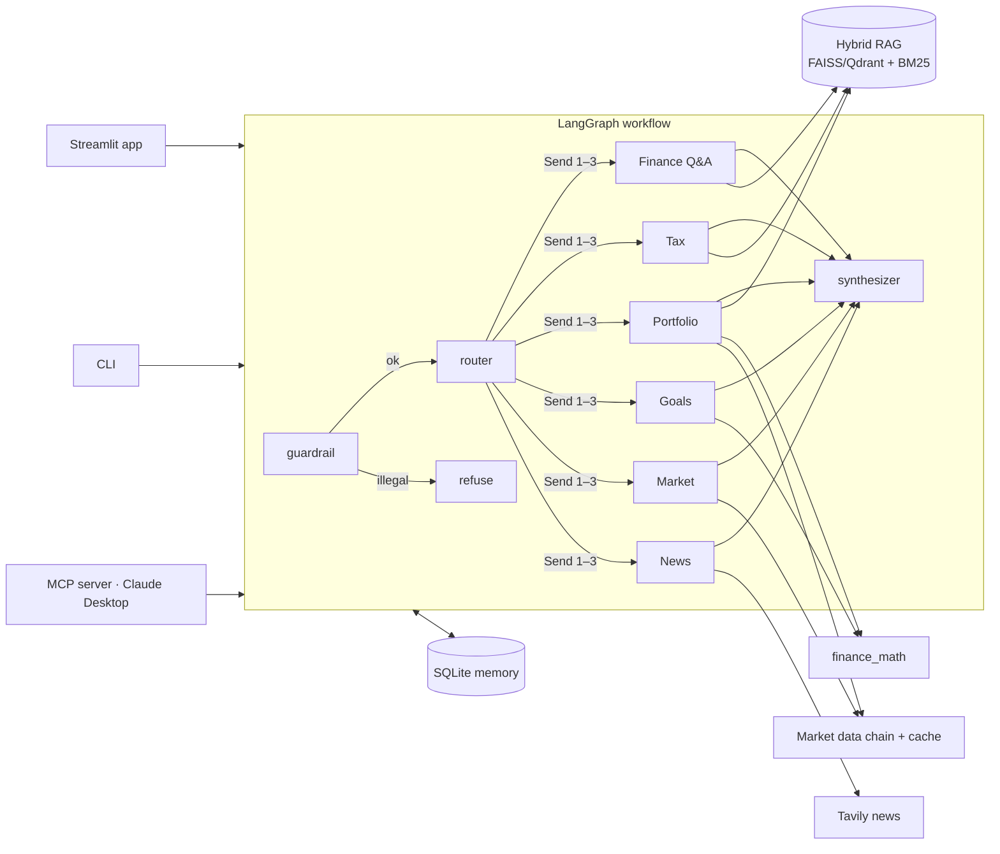

# Finnie — AI Finance Assistant

**A multi-agent financial-education assistant.** Ask about investing, taxes, your portfolio, savings goals,
markets or news. A LangGraph workflow routes each question to one or more of **six specialist agents**,
which answer from a **cited knowledge base** (IRS, SEC Investor.gov) and **live market data**, with every
number computed in Python, never by the LLM. Streamlit UI · CLI · MCP server for Claude Desktop.

> **Educational only — not financial, investment, tax or legal advice.**

| | |
|---|---|
| 🧠 6 agents, parallel fan-out | Finance Q&A · Tax · Portfolio · Goals · Market · News |
| 🔎 Hybrid RAG with citations | FAISS (or Qdrant) + BM25 + RRF · **Recall@5 0.92** · "I don't know" gate |
| 🧭 LLM router + fallback | **95% exact / 98% primary** on 60 labelled questions |
| 🛡️ Guardrails | **18/18** safety prompts · no buy/sell advice · illegal requests refused |
| 📈 Live data with fallbacks | Alpha Vantage → yfinance → mock · 30-min cache · freshness labels |
| 💬 Memory | follow-ups like *"what about for a Roth?"* resolved from the conversation |
| ✅ Quality | **163 tests, 91% coverage** (≥80% enforced in CI) · ~$0.005 and 3–5 s per question |

---

## 1. Architecture



- **Guardrail** (deterministic rules) runs first: illegal requests are refused; "should I buy X?" is
  answered educationally with a clear note.
- **Router** (gpt-4o-mini, structured output) picks 1–3 intents, extracts tickers and rewrites follow-ups
  into standalone questions; keyword rules take over if the LLM fails.
- **Agents** run **in parallel** (`Send`), gather facts with deterministic tools, and ask gpt-4o only to
  *explain* them at the user's level, with citations.
- **Synthesizer** merges results into one answer with sources and the right disclaimer.
- **Shared state + checkpointer** carry the conversation per thread.

Details and trade-offs: **[docs/design.md](docs/design.md)** · Results: **[docs/benchmarks.md](docs/benchmarks.md)**

## 2. Setup

Requires **Python 3.12** and [uv](https://docs.astral.sh/uv/) (or pip).

```bash
git clone <repo-url> && cd capstone-project
uv venv --python 3.12 .venv
.venv\Scripts\activate                 # macOS/Linux: source .venv/bin/activate
uv pip install -r requirements.txt
copy .env.example .env                 # macOS/Linux: cp .env.example .env
python -m scripts.set_keys             # prompts for each key (hidden input) and writes .env
python -m scripts.check_keys           # one live call per service: ✓ / ✗
python -m src.rag.ingest               # build the knowledge-base index (first run downloads the model)
```

| Key in `.env` | Needed? | Without it |
|---|---|---|
| `OPENAI_API_KEY` | **yes** (default provider) | keyword routing + fact-only answers |
| `GOOGLE_API_KEY` | optional — set `llm.provider: gemini` in `config.yaml` | — |
| `ALPHA_VANTAGE_API_KEY` | optional | yfinance, then labelled sample data |
| `TAVILY_API_KEY` | optional | labelled sample news |
| `LANGSMITH_API_KEY` | optional (tracing) | no traces |
| `QDRANT_URL`, `QDRANT_API_KEY` | optional (`rag.vector_store: qdrant`) | FAISS (default) |

`.env` is gitignored and CI fails if it is ever committed. Non-secret settings live in `config.yaml`
(override any value with `FINNIE_<SECTION>__<KEY>`, e.g. `FINNIE_LLM__PROVIDER=gemini`).

**Docker** (after `.env` exists):
```bash
docker compose up --build              # app on http://localhost:8501
```

## 3. Usage

**Web app**
```bash
streamlit run src/web_app/app.py
```
| Tab | What you can do |
|---|---|
| 💬 Chat | ask anything; see which agents answered, charts, and cited sources |
| 📊 Portfolio | edit holdings, pick a sample or upload a CSV → metrics, allocation donuts, sector bar, diversification gauge |
| 📈 Markets | index overview; any ticker with price chart, 20/50-day averages, 52-week range, source + freshness |
| 🎯 Goals | target, years, savings, risk appetite → required monthly saving in 3 scenarios + projection chart |
| 📚 Knowledge | search and browse the knowledge base behind the answers |

The sidebar sets your knowledge level (answers adapt), risk appetite (goal return bands) and horizon.

**Terminal**
```bash
python -m src.workflow.cli                              # interactive chat with memory
python -m src.workflow.cli "What is a Roth IRA?"        # one question
```

**Example questions**
| Question | Agents |
|---|---|
| *What's the traditional IRA contribution limit for 2025?* → *what about for a Roth?* | Tax (cited IRS Pub 590-A; follow-up via memory) |
| *Analyze my portfolio: 10 AAPL, 5 MSFT, 20 VTI, 30 BND* | Portfolio |
| *I want $40,000 for a house in 6 years. I have $5,000 and can add $400 a month.* | Goals |
| *How is NVDA doing, and any news on it?* | Market + News (parallel) |
| *What is an index fund?* | Finance Q&A |
| *Should I buy Tesla?* | reframed: education, no recommendation |

## 4. API and tools

**Python API** — one chat turn:
```python
from langgraph.checkpoint.memory import InMemorySaver
from src.workflow.deps import Deps
from src.workflow.graph import ask, build_graph

app = build_graph(Deps.from_settings(), InMemorySaver())
final = ask(
    app,
    "What is a Roth IRA?",
    thread_id="demo",
    user_profile={"knowledge_level": "beginner", "risk_tolerance": "moderate"},
)
final.answer, final.agents, final.citations, final.data  # FinalResponse (src/core/schemas.py)
```

**MCP server (Claude Desktop)** — 7 tools: `get_quote`, `get_price_history`, `search_news`,
`analyze_portfolio`, `calculate_goal_plan`, `search_knowledge_base`, `ask_finnie`.
```bash
python -m src.mcp_server.server       # stdio; setup in docs/mcp.md
python -m scripts.mcp_smoke_test      # launches it like Claude Desktop does and calls 3 tools
```

**Deterministic tools** (`src/agents/tools.py`, shared by agents, UI and MCP):
`analyze_portfolio(Portfolio, MarketData)`, `plan_goal(GoalInput, GoalsConfig)`, `parse_holdings(text)`,
`parse_goal(text)`, `extract_tickers(text)`. Maths in `src/utils/finance_math.py`.

**RAG**
```bash
python -m src.rag.ingest                                   # rebuild FAISS + BM25 + chunks.json
python -m src.rag.qdrant_index                             # optional: upload to Qdrant
python -m tests.eval.run_retrieval_eval --show-misses      # dense vs sparse vs hybrid
```

## 5. Testing and evaluation

```bash
pytest --cov=src                                           # 163 tests, offline (fake LLM, mocks)
ruff check . && ruff format --check .
python -m tests.eval.run_agent_eval --llm --answers        # routing accuracy + safety (live)
python -m scripts.benchmarks --runs 3                      # latency, tokens, cost, cache, ingest
```

| Evaluation | Result |
|---|---|
| Retrieval, 43 questions, page-level labels | hybrid **R@5 0.92**, MRR 0.73 (dense 0.86, sparse 0.78) |
| Routing, 60 questions | LLM **95% / 98%**, keyword fallback 88% / 92% |
| Safety, 18 prompts | **18/18** guardrail, **9/9** reframed, **4/4** refused |
| Latency / cost | p50 3.1–5.4 s, ~$0.004–0.006 per question |

## 6. Troubleshooting

| Problem | Fix |
|---|---|
| `OPENAI_API_KEY is not set` / answers are just quoted passages | add the key with `python -m scripts.set_keys`; verify with `python -m scripts.check_keys` |
| "sample data" labels on prices | live providers failed: Alpha Vantage's 25/day used up or no key → yfinance → mock. Wait, or check the network |
| `FileNotFoundError ... data/index/chunks.json` | run `python -m src.rag.ingest` |
| First answer takes ~10 s | the embedding model loads once per process; later answers are faster |
| Installing fails on Python 3.13/3.14 | use Python 3.12 (`uv venv --python 3.12`) |
| Qdrant: `collection not found` | `python -m src.rag.qdrant_index` after ingest |
| Claude Desktop doesn't show Finnie tools | absolute paths in the config, full restart; see [docs/mcp.md](docs/mcp.md) |
| No LangSmith traces | `LANGSMITH_API_KEY` set and `LANGSMITH_TRACING=true` in `.env` |
| Edits to `.env` "don't save" | use `python -m scripts.set_keys` instead of an editor |

## Project structure

```
src/core/         config (config.yaml + .env), typed schemas, LLM factory, graph state
src/agents/       BaseAgent + 6 agents, deterministic tools
src/workflow/     LangGraph graph, router, guardrails, synthesizer, deps, CLI
src/rag/          loaders (md/pdf/html/docx), chunking, FAISS / Qdrant / BM25, RRF, retriever, ingest
src/data/         market data chain (Alpha Vantage, yfinance, mock), cache, rate limiter, news
src/utils/        finance math, disclaimers
src/mcp_server/   MCP server + Claude Desktop config example
src/web_app/      Streamlit app, tabs, Plotly charts
data/kb/          knowledge base: articles/ (Markdown), sources/ (PDF/HTML), manifest.yaml
data/reference/   ticker reference data · data/sample_portfolios/ sample CSVs
tests/            unit, integration, eval (retrieval / routing / safety sets + runners)
scripts/          set/check keys, MCP smoke test, benchmarks
docs/             design, benchmarks, chunking strategy, vector store, MCP
```

## Documentation

- [docs/design.md](docs/design.md) — architecture, agent communication, decisions and trade-offs
- [docs/benchmarks.md](docs/benchmarks.md) — retrieval, routing, safety, latency and cost results
- [docs/chunking_strategy.md](docs/chunking_strategy.md) — chunking decision record from corpus profiling
- [docs/vector_store.md](docs/vector_store.md) — FAISS vs Qdrant
- [docs/mcp.md](docs/mcp.md) — Claude Desktop integration
