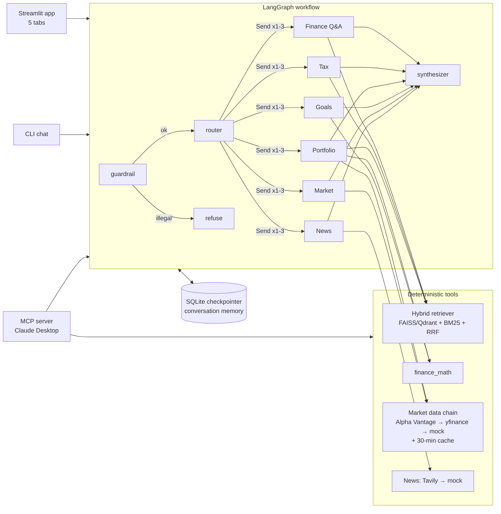

# Finnie — Design

Finnie is a multi-agent financial-education assistant: six specialist agents coordinated by a LangGraph
workflow, grounded in a cited knowledge base and live market data, with a Streamlit UI and an MCP server.
This document explains how it is built and why. Measurements: `docs/benchmarks.md`.

## 1. Architecture



| Layer | Code | Responsibility |
|---|---|---|
| Interfaces | `src/web_app/`, `src/workflow/cli.py`, `src/mcp_server/` | UI, terminal, Claude Desktop |
| Orchestration | `src/workflow/` (graph, router, guardrails, synthesizer) | who answers, in what order, safely |
| Agents | `src/agents/` | one specialist per domain, all on `BaseAgent` |
| Tools | `src/agents/tools.py`, `src/utils/finance_math.py` | facts and numbers, deterministic |
| Data | `src/rag/`, `src/data/` | knowledge base, market data, news |
| Core | `src/core/` | config, typed schemas, LLM factory, graph state |

## 2. Agent communication: shared state, not messages between agents

Agents never call each other. Each graph node reads from and writes a partial update to one typed state
(`src/core/state.py`); reducers define how updates merge:

- `messages` — `add_messages`: the conversation is appended, never overwritten (memory).
- `agent_outputs` — custom merge: parallel agents each add `agent_outputs[intent]` in the same step without
  clobbering each other; reset to `{}` at the start of every turn.
- everything else — last write wins (question, intents, tickers, guardrail result, final answer).

The router fans out with `Send`, giving each selected agent only an `AgentInput` (standalone question,
profile, portfolio, tickers, guardrail note). LangGraph runs those branches in the same super-step (in
parallel) and runs the synthesizer once, after all of them finish.

**Why this over a "supervisor agent that calls tools in a loop":** routing is a classification problem,
so one structured-output call is cheaper, faster, testable (95% on 60 labelled questions) and can't loop.
Parallel fan-out makes multi-part questions ("How is NVDA doing, any news?") cost one round of latency.

## 3. Request lifecycle

1. **Guardrail** (regex, deterministic): illegal requests → refusal, no agent runs. "Should I buy X?" →
   allowed, but every agent must open with "I can't tell you what to buy…" and educate instead.
   Deterministic rules can't be argued away by prompt injection. 18/18 on the safety set.
2. **Router**: gpt-4o-mini with structured output (`RouterDecision`: 1–3 intents, tickers, standalone
   question). It sees the last 6 messages, so "what about for a Roth?" becomes "What is the Roth IRA
   contribution limit?". Any failure → keyword fallback (88%), so routing never blocks an answer.
3. **Agents** (parallel). Each one: gather facts with tools → ask the answer LLM (gpt-4o) to *explain*
   them for the user's knowledge level → return `AgentResult` (answer, citations, structured `data` for
   charts). Exceptions are caught per agent, so one failure doesn't sink a multi-agent answer.
4. **Synthesizer** (deterministic): one agent → its answer; several → one section each; citations
   de-duplicated; tax answers get the tax disclaimer. No second LLM call: less latency, cost and
   hallucination surface.
5. **Checkpointer** (SQLite) stores the state per `thread_id` → memory across turns and restarts.

## 4. The six agents

| Agent | Facts from | Notable behaviour |
|---|---|---|
| Finance Q&A | hybrid retrieval, all categories | numbered citations; **"I don't know"** below the confidence threshold |
| Tax Education | retrieval in `retirement_tax` first, widened if weak | states the tax year; side-by-side comparisons; fixed "not tax advice" footer |
| Portfolio | `analyze_portfolio` (prices → weights, HHI, effective N, mixes, costs, volatility) + KB context | observations describe, never instruct |
| Goal Planning | LLM extraction → `plan_goal` (inflation, PMT, FV per return band) | refuses to invent a goal when the message has no numbers |
| Market | `MarketData.snapshot` (52-week range, SMA20/50, 1m/6m returns, trend rule) | always says source, time, cached/sample |
| News | Tavily web search (7 days) | summarized with source numbers; labelled sample news on failure |

**The LLM never does arithmetic.** Every number is computed in `finance_math.py` (unit-tested) and passed
in as a fact; the prompt forbids inventing numbers. This removes the most common failure of finance bots.

**Degraded mode:** with no LLM key, every agent still returns its facts (retrieved passages, metrics,
scenarios), and routing uses keywords. Tested in `test_degraded_mode_without_llm_still_answers`.

## 5. RAG

- **Corpus**: IRS Publications 590-A and 969 (PDF), SEC Investor.gov pages (HTML), Markdown articles;
  every non-Markdown source registered in `data/kb/manifest.yaml` (title, URL, category, tax year) —
  ingestion refuses unregistered files, so every answer is citable.
- **Loaders** (from profiling the real documents, `notebooks/profile_corpus.py`): PDF page-level docs with
  header/footer stripping, de-hyphenation and **section names from PDF bookmarks**; HTML boilerplate
  removal and h2–h4 sectioning; DOCX heading styles; Markdown `##` sections.
- **Chunking**: structure-aware recursive (paragraph → sentence → hard cut), 800 chars, 120 overlap,
  **contextual header** (title — section) prepended for embedding. Decision record:
  `docs/chunking_strategy.md`.
- **Retrieval**: dense (`all-MiniLM-L6-v2`, FAISS `IndexFlatIP`, cosine) + sparse (BM25 with a finance
  tokenizer: `401(k)`→`401k`, `S&P`, `P/E`) fused with **Reciprocal Rank Fusion**. Hybrid beats dense by
  6 points and sparse by 14 (Recall@5 0.92).
- **Confidence gate**: RRF scores only encode rank, so confidence uses the best **dense cosine** (≥ 0.35).
  Off-topic questions are refused 7/7.
- **Vector store**: FAISS by default; Qdrant (Cloud or local) behind the same `VectorIndex` protocol —
  identical quality, ~100 ms network latency; the benchmark exposed and fixed an N+1 lookup
  (`docs/vector_store.md`).

## 6. Market data and news

```
cache hit? → yes → return (is_cached)          Alpha Vantage: 5/min, 25/day budget enforced
   no → Alpha Vantage → yfinance → mock         before calling (persisted rate limiter);
        (live results cached 30 min on disk;    timeouts + 2 retries on network errors;
         mock never cached)                      "Note"/malformed JSON → next provider
```
Every quote carries `source`, `as_of`, `is_cached`, `is_mock`, and the UI shows them, so users always know
how fresh a number is. The disk cache survives restarts, which protects the 25/day quota.

## 7. Key decisions and trade-offs

| Decision | Alternatives | Why |
|---|---|---|
| LangGraph with explicit nodes + `Send` fan-out | supervisor agent with tool loop; CrewAI | predictable, parallel, testable, checkpointing built in |
| Structured-output router + keyword fallback | pure keywords; embedding classifier | 95% vs 88%; fallback keeps it working without an LLM |
| Deterministic guardrails before routing | LLM moderation only | can't be prompt-injected; zero latency; 100% on the safety set |
| Facts from tools, LLM only explains | LLM answers directly | no invented numbers; numbers are unit-tested |
| Deterministic synthesizer | LLM merge | lower latency/cost, no extra hallucination |
| FAISS default, Qdrant optional | Chroma, pgvector | exact search in ms at this size; Qdrant for shared/live indexes |
| Hybrid retrieval with RRF | dense only | +6 points recall; exact terms and paraphrases both covered |
| gpt-4o-mini (router) + gpt-4o (answers), Gemini switchable | one model | cost/latency where quality matters less |
| MCP server (stdio) | A2A | standard tool access for Claude Desktop now; A2A only pays off for separately deployed agents |
| Streamlit | React + API | rubric requirement and speed; the backend is UI-agnostic (`ask()`), so a React front-end is a later add-on |

## 8. Performance and observability

- p50 3–5 s per question (answer LLM dominates), ~$0.005 per question; retrieval ~4 ms.
- LangSmith tracing (env-configured) shows every node, LLM call and token count per question.
- `MarketData.stats` counts cache hits, fallbacks and provider errors.
- Scaling path: stream tokens to the UI; cache LLM answers for repeated questions; move the index to Qdrant
  and the checkpointer to Postgres for multiple app instances.

## 9. Testing strategy

- **Unit**: finance math edge cases (empty, single holding, zero rate, already-reached goal), parsers,
  guardrails, router, loaders, chunking, indexes, providers with mocked HTTP (rate-limit notes, malformed
  JSON, HTTP 500, timeouts + retry, budgets that survive restarts), charts.
- **Integration**: full graph per intent with a fake LLM, multi-intent fan-out, memory per thread,
  per-turn reset, degraded mode, MCP tools via the MCP API, ingest → retrieve, FAISS vs Qdrant parity.
- **Evaluation** (live, not in CI): retrieval (43 Q), routing (60 Q), safety (18 prompts).
- CI: ruff lint + format, secret check, 163 tests offline, **coverage ≥ 80% enforced** (currently 91%).

## 10. Limitations

- Educational only — no personalized advice by design; tax content covers 2025 IRS publications.
- Corpus is PDF-heavy; more plain-language articles would help beginner questions.
- Free market-data tiers: Alpha Vantage 25 requests/day (then yfinance); yfinance is unofficial.
- English, US-centric content.
